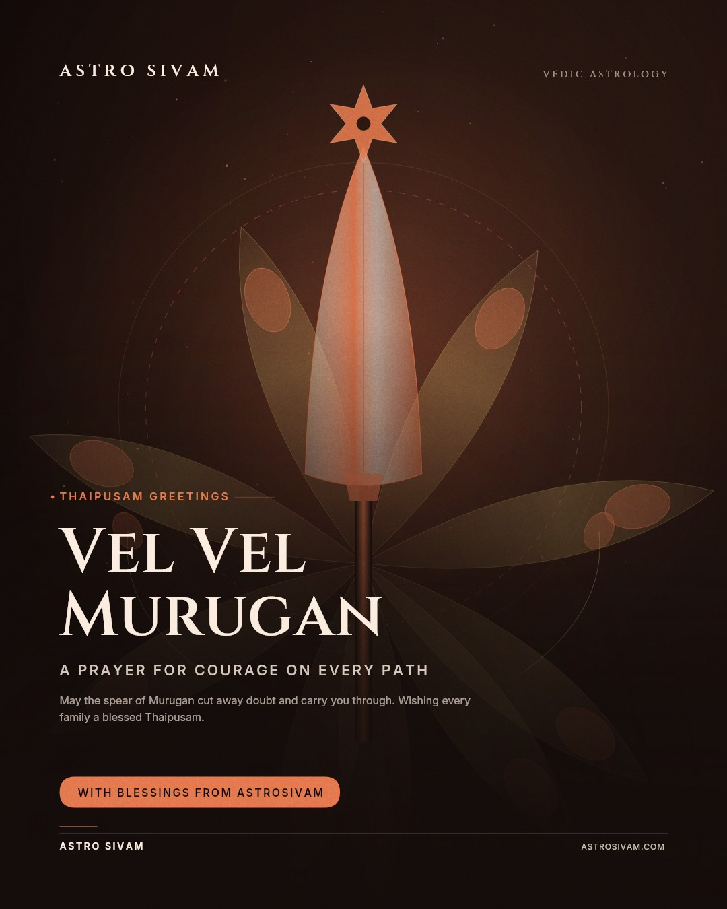
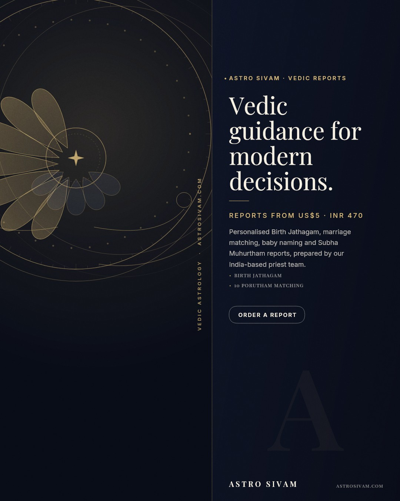
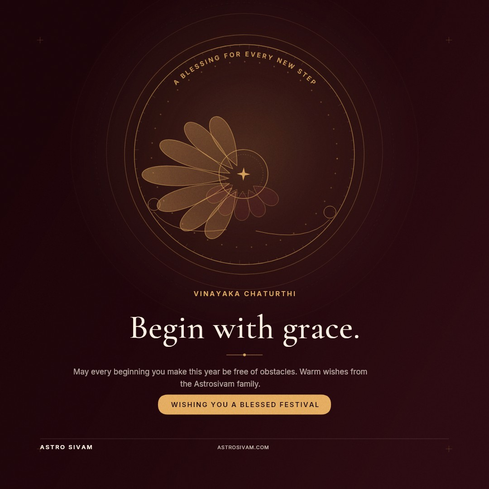
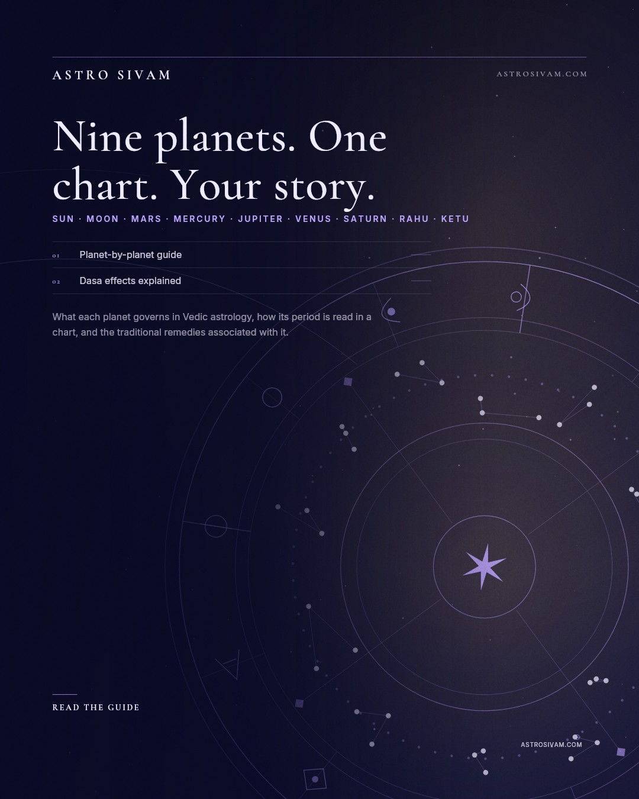

# Astro Sivam Creative Studio

A production-quality poster and motion studio for **ASTRO SIVAM** (astrosivam.com) — built with React 19, TypeScript, Vite and Tailwind CSS. Posters are composed by a custom canvas design engine, not by recolouring one template: **15 composition systems**, **21 original vector motifs**, **14 palettes**, 7 bundled font families, live editing, real PNG/JPEG export and real video recording.

> Service names, prices, inclusions and the ordering process shown in the studio were transcribed from astrosivam.com on **2 November 2026**. Check the live site before publishing any price.

---

## Gallery

Every image below is rendered by the shipped engine (`npm run samples`), not a mockup.

| | | | |
| --- | --- | --- | --- |
|  |  |  |  |


## Highlights

- **15 distinct composition systems** — hero illustration, editorial type, asymmetric luxury, circular mandala, diagonal geometric, cosmic astrology, split panel, illustrated story, minimal luxury, premium infographic, layered collage, cinematic devotional, Swiss grid, decorative frame, bold campaign. Each has its own geometry, focal point, hierarchy, artwork placement and background construction.
- **Intelligent selection** — scores every composition by category shortlist, aspect ratio, headline/body length, number of points and recency; regenerating never repeats the current layout or the previous two.
- **Original artwork** — procedural vector illustration with gradients, engraving, lighting and layered texture. No stock photos, no clipart borders, no glow spam.
- **Full editor** — content, typography, colours, background, spacing, artwork, logo, composition, palette, motion, undo/redo, duplicate, regenerate, reset, save/reopen locally.
- **Real formats** — 1080×1350, 1080×1080, 1080×1920, Facebook sizes and custom; changing format re-lays out the composition instead of stretching it.
- **Real exports** — PNG/JPEG at 1×–3×, multi-size export, and video via `MediaRecorder` (MP4 when the browser supports H.264, otherwise WebM — labelled honestly).
- **Preflight** — text overflow, clipping, safe-margin and contrast checks are measured from the real render before export.
- **Works with zero services** — no AI key, no backend, no account. Everything optional lives behind explicit configuration.

## Quick start

```bash
npm install
cp .env.example .env      # optional values only
npm run dev               # http://localhost:5173
npm run typecheck         # strict TS across app + scripts
npm test                  # engine test suite (154 checks)
npm run samples           # rebuilds 30 sample posters in public/samples
npm run build             # production bundle in dist/
```

Node 20+ is required. The sample generator uses `@napi-rs/canvas` so the same engine renders headlessly in CI.

## Project structure

```
src/
  engine/                 pure rendering + composition system (no React)
    types.ts              DesignSpec, content, palette, art, animation contracts
    formats.ts            canvas sizes and aspect classes
    color.ts  palettes.ts  fonts.ts  text.ts  draw.ts  fx.ts  layout.ts
    artwork/              21 procedural motifs + registry
    frame.ts              per-composition toolkit (text, art, logo, timeline, report)
    compositions/         15 composition modules + shared helpers
    selection.ts          scoring + recency-aware picker
    presets.ts            design factory, defaults, regeneration
    renderer.ts           renderDesign() — the single render path
    services.ts           verified Astro Sivam service/pricing reference
  lib/                    browser font loading, canvas export, AI provider interface
  state/                  studio store (history, autosave), local + optional remote storage
  components/             UI primitives, preview canvas, studio panels, cloud sync
  pages/                  Dashboard, Studio, Projects, Services, Brand, Guide
scripts/
  render-samples.mts      30 full-size sample posters + manifest
  test-engine.mts         registry, selection, rendering, contrast, overflow tests
public/
  samples/                generated gallery (30 JPEGs + manifest.json)
  api/                    optional PHP backend (auth, projects, AI proxy)
db/schema.sql             optional MySQL schema
docs/DEPLOYMENT.md        hosting, backend and provider notes
```

## How the engine works

`renderDesign(ctx, { spec, width, height, time, assets, quality })` is the only render path used by the editor preview, thumbnails, PNG/JPEG export, video frames and the Node sample generator.

Each composition receives a `Frame` with the safe rectangle, unit scale, palette, typography stacks, artwork helper, logo helper, timeline and a report builder. Text is measured against its real box, so overflow is detected rather than hidden. The report is what powers the preflight panel.

Selection (`selectComposition`) restricts candidates to the category's shortlist, then scores aspect fit, content shape, format support and recency (current + previous two are effectively excluded).

## Formats

| Format | Size | Notes |
| --- | --- | --- |
| Instagram portrait | 1080×1350 | default feed post |
| Square | 1080×1080 | IG + FB feed |
| Story / Reel cover | 1080×1920 | extra safe zones top/bottom |
| Facebook portrait / square | 1080×1350 / 1080×1080 | feed |
| Facebook landscape | 1200×628 | link/event banners |
| Custom | 320–4096 px | any ratio |

The Export panel's **resize set** re-renders the design at each selected size.

## Motion & video

Animation is part of the composition tree: staggered text reveals, seeded particles, artwork parallax, light sweeps and scene transitions (fade/wipe/zoom). The Motion panel scrubs the same timeline used for export.

Video export records the live canvas with `MediaRecorder`:
- MP4 (H.264) when the browser exposes the encoder — typically Chromium on desktop.
- WebM (VP9/VP8) otherwise.
- Real time, 1080 px long edge, 2–20 s, 24/30/60 fps.
- If no codec exists the UI says so. There is no simulated progress or fake success.

A guaranteed MP4 on every device needs server-side ffmpeg; that is intentionally not bundled.

## Services & pricing (verified from astrosivam.com)

| Service | Price | Delivered |
| --- | --- | --- |
| Birth Jathagam — Basic | US$5 / ₹470 | PDF, priest-reviewed |
| Birth Jathagam — Bhava | US$10 / ₹940 | PDF, priest-reviewed |
| Birth Jathagam — Varga | US$10 / ₹940 | PDF, priest-reviewed |
| Marriage Compatibility (10 Porutham) | US$5 / ₹470 | PDF |
| Baby Naming (Namakaranam) | US$5 / ₹470 | Certificate PDF |
| Subha Muhurtham | US$10 / ₹940 | 6-month date matrix PDF |

Ordering: choose a report → enter birth details → India-based priest team prepares and reviews → PDF + tax invoice emailed after approval (reviews every 6 hours). Reports are available in English, Tamil or Hindi; the studio's poster copy remains English-only by design.

All of this lives in [`src/engine/services.ts`](src/engine/services.ts) with a retrieval date. The **Services** page in the app shows the full inclusions, four-step process and FAQ, and can seed a poster from any service.

## Logo policy

The repository contains **no Astro Sivam logo**, and the studio never generates, traces or substitutes one. Only the official asset from **astrosivam.com** (or the file supplied by the brand owner) may be uploaded in **Brand settings**. Until then, posters use a typographic wordmark.

## Optional AI imagery

The studio is complete without it. To enable generated artwork:

1. Deploy `public/api/generate.php` with `AI_PROVIDER` and `AI_API_KEY` set **server-side**.
2. Set `VITE_AI_ENDPOINT=/api/generate.php` at build time.
3. Optionally set `AI_PROXY_TOKEN` and send it as `X-Proxy-Token`.

The provider interface in `src/lib/provider.ts` can be extended or replaced. Any provider call is paid and requires its own account; the app labels provider output clearly and never claims it as studio illustration.

## Optional cloud storage

Local storage is the default and needs no account. To enable cross-device storage:

1. Import `db/schema.sql` into MySQL/MariaDB.
2. Configure `public/api/config.php` via server environment variables (`DB_DSN`, `DB_USER`, `DB_PASS`, `APP_ORIGIN`).
3. Set `VITE_API_BASE` to the API folder and rebuild.

Security: hashed passwords (`password_hash`), HttpOnly + SameSite session cookies, login throttling, per-user query scoping, JSON size limits, MIME validation, CORS restricted to `APP_ORIGIN`. See `docs/DEPLOYMENT.md`.

## Testing

```bash
npm test      # 154 assertions
npm run samples
```

Coverage includes: 15 registered compositions, category wiring, 60 selection seeds per category, 8 regenerations per category without repeats, all 15 compositions in all 4 aspect classes with zero error-level issues, every motif renders, palette contrast ≥ 3:1, overflow detection, empty-headline detection, exact export dimensions, non-blank pixels, and render time.

## Deployment

Static hosting is enough. `npm run build` emits `dist/`; SPA rewrites are provided for Apache (`public/.htaccess`), Vercel (`vercel.json`) and Netlify (`netlify.toml`). See [`docs/DEPLOYMENT.md`](docs/DEPLOYMENT.md) for the PHP backend.

## Limitations

- Video export depends on the browser codec and records in real time (30 s cap).
- Seven bundled Latin families; non-Latin glyphs fall back.
- Browser storage is per-device and can be cleared; export to keep artwork.
- No Facebook/Instagram publishing: that needs Meta app review and page tokens, which are out of scope and not faked.
- AI artwork requires your own provider key; cost and quality are the provider's.
- Some compositions intentionally keep their own alignment and logo corner.
- The optional backend is a single-tenant starter, not a multi-tenant SaaS.

## Credits

Design engine, compositions and UI built for ASTRO SIVAM. Service facts © astrosivam.com. Fonts: Playfair Display, Cormorant Garamond, Cinzel, Marcellus, Montserrat, Space Grotesk, Inter (SIL Open Font License, via Fontsource).
